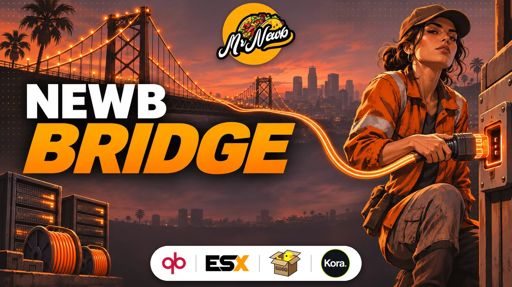
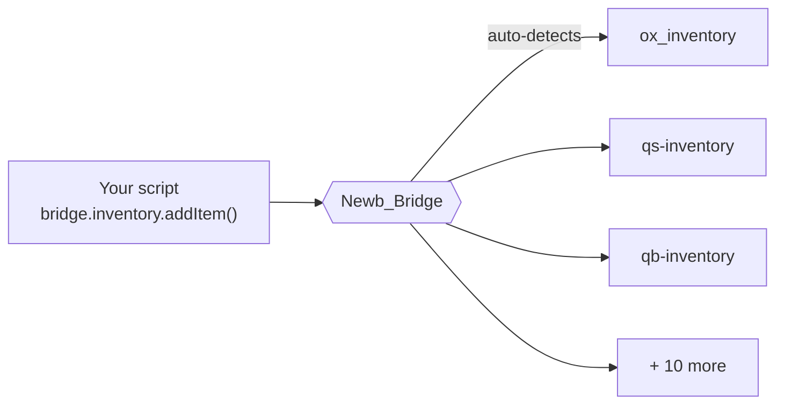

<div align="center">



# Newb_Bridge

**One bridge between my scripts and whatever your server runs.**

[Documentation](https://mrnewb.github.io/docs/newb_bridge) · [Install guide](https://mrnewb.github.io/docs/newb_bridge/getting-started) · [Tebex](https://mrnewbscripts.tebex.io/) · [Discord](https://discord.gg/mrnewbscripts)

[](https://github.com/MrNewb/Newb_Bridge/releases/latest/download/Newb_Bridge.zip)
[](https://github.com/MrNewb/Newb_Bridge/releases/latest/)
[](https://5metrics.dev/resource/Newb_Bridge)
[](https://5metrics.dev/resource/Newb_Bridge)
[](https://5metrics.dev/resource/Newb_Bridge)

</div>

---

I got tired of writing the same framework, inventory and target code in every script, so I wrote it once. Newb_Bridge sits underneath MrNewbScripts and translates a single set of `bridge.*` calls into whatever you have installed: Qbox, QBCore or ESX, ox_inventory or qs-inventory, ox_target or qb-target. Your stack doesn't matter, and nothing gets rewritten.

> [!TIP]
> **Here for a MrNewbScripts product?** Install this once, start it before the script, and you're done. There's no code to write.

> [!NOTE]
> **Building your own scripts?** You're welcome to use it. Just read [Scope and maintenance](#scope-and-maintenance) first.

## How it works



The same call works on every stack:

| You call | Qbox + ox | QBCore + qs | ESX + qb-target |
|---|:---:|:---:|:---:|
| `bridge.framework.addMoney` | ✅ | ✅ | ✅ |
| `bridge.inventory.addItem` | ✅ | ✅ | ✅ |
| `bridge.target.addEntity` | ✅ | ✅ | ✅ |

## Why it exists

My scripts go out to servers running every combination of framework, inventory, target and UI you can think of. Supporting all of that inside each script means copying the same adapter code dozens of times, and every new provider means touching every script.

Moving it into one place fixes that:

- **Write once.** A script calls `bridge.inventory.addItem(...)` and never asks which inventory is installed.
- **Fix once.** A provider fix lands in the bridge and every script gets it.
- **Feels the same everywhere.** Menus, notifications, inputs, progress bars and text UI look and behave alike across my scripts, and share one [colour palette](#server-colour-palette).
- **Only pay for what you run.** Nothing loads until a script actually asks for it. If you don't run a dispatch resource, the dispatch module never loads, so it never costs you memory or startup time.

It's also the spiritual successor to [Community Bridge](#a-note-on-community-bridge): same idea, started over with a tighter scope and lazy loading from the first line.

## What it is, and isn't

It's a small set of focused modules, plus a few shared tools my scripts lean on: interaction points, a prop placer, a gizmo, a task HUD and dialogue.

It's not a kitchen sink. There's no catch-all layer for old exports and nothing that exists just because someone once asked. That's what keeps it fast and predictable.

ox_lib, ox_inventory and ox_target are the reference implementations, and every other provider maps onto the same calls.

## Getting started

You'll need [ox_lib](https://github.com/overextended/ox_lib), [oxmysql](https://github.com/overextended/oxmysql) and a server with `lua54`. Drop the folder into your resources and start it before anything that uses it:

<details open>
<summary><b>Qbox</b></summary>

```cfg
ensure ox_lib
ensure oxmysql
ensure qbx_core
ensure ox_inventory
ensure ox_target
ensure Newb_Bridge

ensure your_script
```

</details>

<details>
<summary><b>QBCore</b></summary>

```cfg
ensure ox_lib
ensure oxmysql
ensure qb-core
ensure qb-inventory
ensure qb-target
ensure Newb_Bridge

ensure your_script
```

</details>

<details>
<summary><b>ESX</b></summary>

```cfg
ensure ox_lib
ensure oxmysql
ensure es_extended
ensure ox_inventory
ensure ox_target
ensure Newb_Bridge

ensure your_script
```

</details>

Swap in whichever inventory and target you actually run. The bridge detects them on its own. It only needs to start after them and before your script.

If you're writing a script, add this to its `fxmanifest.lua`:

```lua
shared_scripts {
    '@ox_lib/init.lua',
    '@Newb_Bridge/import.lua',
}
```

The online docs cover the rest: [install steps](https://mrnewb.github.io/docs/newb_bridge/getting-started), [every setting](https://mrnewb.github.io/docs/newb_bridge/configuration), [supported resources](https://mrnewb.github.io/docs/newb_bridge/supported) and [troubleshooting](https://mrnewb.github.io/docs/newb_bridge/troubleshooting).

## Using it

```lua
-- Server
bridge.inventory.addItem(source, 'water', 1)
bridge.framework.addMoney(source, 'cash', 500)

-- Client
bridge.notifications.notify({ description = 'Hello', type = 'success' })
bridge.menu.openMenu({ id = 'my_menu', title = 'Shop', options = { ... } })
```

That runs the same on Qbox, QB or ESX. UI modules take ox_lib-shaped tables, so code written for ox_lib moves over with very little change.

The full method list lives in the [docs](https://mrnewb.github.io/docs/newb_bridge/developers/modules). For editor autocomplete, point LuaLS at [`resource/types/types.lua`](resource/types/types.lua).

## Configuring it

Open `settings/bridge_resources.lua`. Every setting ships as `"auto"`, which picks the first installed match. If you want to pin a specific resource, just put its name in.

```lua
Config.Framework = "auto"      -- qbx_core, qb-core, es_extended
Config.Inventory = "auto"      -- ox_inventory, qs-inventory, qb-inventory, ...
Config.Target = "auto"         -- ox_target, core_focus, qb-target, ...
Config.Menu = "auto"           -- ox_lib, lation_ui, qb-menu
Config.Notifications = "auto"
```

On start, the server console tells you which provider each module settled on. If you delete a setting, or a newer version adds one your file doesn't have, it falls back to the shipped value.

> [!WARNING]
> When you update, keep your `settings/` folder and replace everything else.

## What's in the box

| Module | Side | Docs |
|---|:---:|---|
| `bridge.framework` | client / server | [Framework](https://mrnewb.github.io/docs/newb_bridge/developers/modules/framework) |
| `bridge.inventory` | client / server | [Inventory](https://mrnewb.github.io/docs/newb_bridge/developers/modules/inventory) |
| `bridge.target` | client | [Target](https://mrnewb.github.io/docs/newb_bridge/developers/modules/target) |
| `bridge.menu` | client | [Menu](https://mrnewb.github.io/docs/newb_bridge/developers/modules/menu) |
| `bridge.notifications` | client | [Notifications](https://mrnewb.github.io/docs/newb_bridge/developers/modules/notifications) |
| `bridge.inputs` | client | [Inputs](https://mrnewb.github.io/docs/newb_bridge/developers/modules/inputs) |
| `bridge.textui` | client | [TextUI](https://mrnewb.github.io/docs/newb_bridge/developers/modules/textui) |
| `bridge.progressbar` | client | [Progress bar](https://mrnewb.github.io/docs/newb_bridge/developers/modules/progressbar) |
| `bridge.vehiclekeys` | client / server | [Vehicle keys](https://mrnewb.github.io/docs/newb_bridge/developers/modules/vehiclekeys) |
| `bridge.vehiclefuel` | client / server | [Vehicle fuel](https://mrnewb.github.io/docs/newb_bridge/developers/modules/vehiclefuel) |
| `bridge.bossmenu` | server | [Boss menu](https://mrnewb.github.io/docs/newb_bridge/developers/modules/bossmenu) |
| `bridge.dispatch` | server | [Dispatch](https://mrnewb.github.io/docs/newb_bridge/developers/modules/dispatch) |
| `bridge.banking` | server | Society accounts |
| `bridge.doorlock` | client / server | Door locking |
| `bridge.phone` | server | Phone emails and numbers |
| `bridge.weather` | client | Weather sync toggle |
| `bridge.dialogue` | client | [Dialogue](https://mrnewb.github.io/docs/newb_bridge/developers/modules/dialogue) |
| `bridge.task` | client | [Task HUD](https://mrnewb.github.io/docs/newb_bridge/developers/modules/task) |
| `bridge.theme` | client / server | [Colour palette](#server-colour-palette) |

There are a few extras too, like `AddInteraction`, `PropPlacer`, `useGizmo` and `VersionCheck`. See [Utilities](https://mrnewb.github.io/docs/newb_bridge/developers/utilities).

<details>
<summary>Supported providers</summary>

| Category | Providers |
|---|---|
| Framework | whip_core, kora_core, qbx_core, qb-core, es_extended |
| Inventory | whip_core, kora_inventory, ox_inventory, wasabi_inventory, m-Inventory, one_inventory, jaksam_inventory, tgiann-inventory, codem-inventory, core_inventory, origen_inventory, qs-inventory, qb-inventory |
| Target | whip_core, kora_target, ox_target, tgiann-target, core_focus, qb-target, sleepless_interact |
| Vehicle keys | whip_core, MrNewbVehicleKeys, kora_vehiclekeys, jg-vehiclekeys, qbx_vehiclekeys, cd_garage, mVehicle, okokGarage, qb-vehiclekeys, vehicles_keys, wasabi_carlock, Renewed-Vehiclekeys, mk_vehiclekeys, ak47_vehiclekeys, 0r-vehiclekeys |
| Fuel | whip_fuel, ox_fuel, rcore_fuel, okokGasStation, LegacyFuel, cdn-fuel, lc_fuel, qb-fuel, Renewed-Fuel, ps-fuel, qs-fuelstations, ti_fuel (plus an internal fallback) |
| Menu | ox_lib, lation_ui, qb-menu |
| Notifications | whip_core, ox_lib, vms_notifyv2, codem-notification, brutal_notify, fl-notify, mythic_notify, okokNotify, pnotify, solaire_notify, t-notify, lation_ui, wasabi_notify, ZSX_UIV2 |
| Inputs | whip_core, ox_lib, lation_ui |
| TextUI | whip_core, ox_lib, lation_ui, okokTextUI, cd_drawtextui, jg-textui, lab-TextUI, ZSX_UIV2 |
| Progress bar | whip_core, ox_lib, lation_ui, wasabi_uikit, progressbar, ZSX_UIV2 |
| Boss menu | qbx_management, qb-management, esx_society, vms_bossmenu, tk_bosstablet, okokBossMenu, codem-bossmenu, zat-bossmenu, m-BossMenu, lation_jobs, ShitDevScripts-Bossmenu, apex_bossmenu |
| Banking | Renewed-Banking, qb-banking, okokBanking, lation_banking, fd_banking, kartik-banking, tgg-banking, tgiann-bank, wasabi_banking, esx_addonaccount, ShitDevScripts-Banking |
| Doorlock | ox_doorlock, qb-doorlock, rcore_doorlock, doors_creator |
| Phone | kora_phone, sd-phone, sky_phone, lb-phone, gksphone, okokPhone, qs-smartphone, yseries, qb-phone |
| Weather | Renewed-Weathersync, qb-weathersync, cd_easytime |
| Dispatch | ps-dispatch, cd_dispatch, tk_dispatch, rcore_dispatch, lb-tablet, origen_police, core_dispatch, kartik-mdt, codem-dispatch, wasabi_mdt, redutzu-mdt (plus an internal fallback) |

Detection order lives in [`settings/auto_detect.lua`](settings/auto_detect.lua). Two values aren't resources: `internal` is the bridge's own built-in version, and `none` means nothing was found, so that module quietly does nothing.

Want a provider added? Copy an existing folder under `resource/modules/<category>/` and open a PR.

</details>

<details>
<summary>How it keeps other scripts light</summary>

- The `newb_bridge_host 'yes'` line in `fxmanifest.lua` marks the resource that runs the bridge. Keep it if you rename the folder. Scripts ask that resource for each module once, instead of hunting through the disk.
- The prop placer, zone creator, DUI surface and dialogue tools load on their first call, not at start. `exports.Newb_Bridge:LazyToolsLoaded()` shows which ones have.
- On the client, `bridge.framework.getIsPlayerLoaded`, `getPlayerJobData`, `hasJob` and `isOnDuty` are answered from a copy inside the calling script. It's refreshed when `Newb_Bridge:client:playerLoaded`, `playerUnloaded` or `playerJobUpdated` fires.
- Icons come from the Font Awesome webfonts. Nothing downloads at start, and each font file (solid 115 KB, regular 19 KB, brands 110 KB) loads the first time an icon of that style appears.

</details>

## A note on Community Bridge

[Community Bridge](https://github.com/TheOrderFivem/community_bridge) is still maintained if you're on it, and nothing here forces you off.

I'll be straight about why this exists. I wanted that project to work, but it grew so far past its original scope that pulling it back wasn't something a few PRs could fix. And I can't just trim it: plenty of resources depend on its exports, some from authors who've moved on, and many ship escrowed. If an export vanished, server owners couldn't open the file to patch the call. So Community Bridge keeps its compatibility, and I keep maintaining it for the creators and servers that rely on it.

Newb_Bridge is what I'd write starting over. It's a successor in intent, not a fork, and no Community Bridge source ships here. The interaction and spawn pipeline is a ground-up rewrite that borrows the model, and anything genuinely derived from another project is credited in [ATTRIBUTIONS.md](ATTRIBUTIONS.md).

Coming over? There are per-module notes in [Migrating from community_bridge](https://mrnewb.github.io/docs/newb_bridge/developers/migrating).

## Scope and maintenance

> [!IMPORTANT]
> Worth a read before you build something load-bearing on this.

- **It's just me.** One maintainer, one roadmap, no team and no plan for one.
- **The scope is narrow on purpose.** It covers what MrNewbScripts needs. A provider or module nothing of mine uses is unlikely to land, however reasonable the request.
- **Deprecations are short.** Anything marked deprecated gets two weeks, then it's removed. Check the changelog in that window, or pin a release tag if that pace doesn't suit you.
- **Issues and PRs are welcome.** Bug reports, provider fixes and new provider folders are the likeliest to be merged. If something needs a chat first, find me on [Discord](https://discord.gg/mrnewbscripts).

None of this limits what the licence gives you. It's GPL-3.0, so fork it if my scope doesn't fit yours. I just don't want anyone planning around a support model that doesn't exist.

## Server colour palette

`settings/theme.lua` holds the colours every Newb UI shares: backgrounds, text, the primary and accent colours, the exit button, and the success, warning, danger and info colours. Change a value, restart Newb_Bridge, then restart the resources using it.

Each token becomes a CSS variable named `--newb-<token-in-kebab-case>`, so `closeHover` is `--newb-close-hover`. Hover, soft and border variants are derived for the status, primary, accent and close colours.

<details>
<summary>Using the palette in your own UI</summary>

In the script's client Lua (it already imports the bridge):

```lua
bridge.theme.register()
```

In the UI, ask for the palette once the page loads and apply it. Newb_Bridge also pushes a `NEWB_THEME` message with the same payload:

```ts
const payload = await fetch(`https://${GetParentResourceName()}/newbTheme`, { method: 'POST', body: '{}' }).then((r) => r.json())
for (const [name, value] of Object.entries(payload.vars)) document.documentElement.style.setProperty(name, value)
```

Read the variables with a fallback, so the UI looks right with or without the palette and keeps its own layout:

```css
.panel { background: var(--newb-surface, #171717); color: var(--newb-text, #fafafa); }
```

From Lua, `bridge.theme.get()` returns the tokens, `bridge.theme.vars()` the CSS variable map and `bridge.theme.css()` a ready-made `:root{...}` string. Other resources can call `exports.Newb_Bridge:GetTheme()` and `exports.Newb_Bridge:GetThemeCss()`.

</details>

---

<div align="center">

**Everything else lives in the [MrNewb docs](https://mrnewb.github.io/docs/).**

</div>

<details>
<summary><b>License, folder layout and attributions</b></summary>

### License

The Lua resource is **GPL-3.0-only**, see [LICENSE](LICENSE). It comes WITHOUT ANY WARRANTY; without even the implied warranty of MERCHANTABILITY or FITNESS FOR A PARTICULAR PURPOSE.

[`import.lua`](import.lua) carries LGPL-3.0-or-later notices from ox_lib and is conveyed under GPL-3.0. The LGPL text is in [LICENSES/LGPL-3.0.txt](LICENSES/LGPL-3.0.txt).

The NUI in `web/` is original to this project and ships permissively licensed dependencies (React, Font Awesome) whose notices are kept in the built assets.

### What's inside the folder

- `settings/` is the one you edit: providers, theme and the auto-detect lists.
- `locales/` holds the translations.
- `resource/` is the bridge itself. You shouldn't need to touch it.
- `import.lua` is what other scripts load, so it stays in the root.
- `web/` is the built UI.

### Attributions

Adapted code from other projects is listed in [ATTRIBUTIONS.md](ATTRIBUTIONS.md).

</details>
