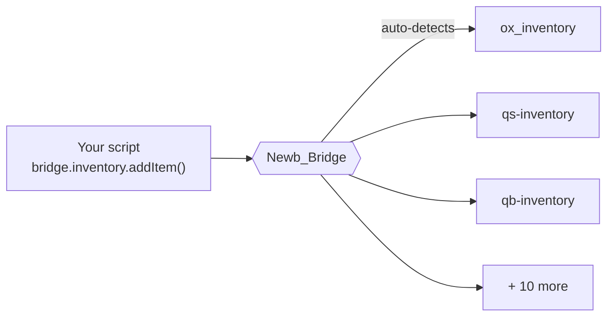

<div align="center">


# Newb_Bridge

**One bridge between my scripts and whatever your server runs.**

[Documentation](https://mrnewb.github.io/docs/newb_bridge) · [Install guide](https://mrnewb.github.io/docs/newb_bridge/getting-started) · [Tebex](https://mrnewbscripts.tebex.io/) · [Discord](https://discord.gg/mrnewbscripts)

[](https://github.com/MrNewb/Newb_Bridge/releases/latest/download/Newb_Bridge.zip)
[](https://github.com/MrNewb/Newb_Bridge/releases/latest/)
[](https://5metrics.dev/resource/Newb_Bridge)
[](https://5metrics.dev/resource/Newb_Bridge)
[](https://5metrics.dev/resource/Newb_Bridge)

</div>

---

I got tired of writing the same framework, inventory and target code in every script, so I wrote it once. Newb_Bridge sits underneath MrNewbScripts and translates a single set of `bridge.*` calls into whatever you have installed: Qbox, QBCore or ESX, ox_inventory or qs-inventory, ox_target or qb-target. Your stack doesn't matter, and nothing gets rewritten.

> [!TIP]
> **Here for a MrNewbScripts product?** Install this once, start it before the script, and you're done. There's no code to write.

> [!NOTE]
> **Building your own scripts?** You're welcome to use it. Just read [Scope and maintenance](#scope-and-maintenance) first.

## How it works



The same call works on every stack:

| You call | Qbox + ox | QBCore + qs | ESX + qb-target |
|---|:---:|:---:|:---:|
| `bridge.framework.addMoney` | ✅ | ✅ | ✅ |
| `bridge.inventory.addItem` | ✅ | ✅ | ✅ |
| `bridge.target.addEntity` | ✅ | ✅ | ✅ |

## Why it exists

My scripts go out to servers running every combination of framework, inventory, target and UI you can think of. Supporting all of that inside each script means copying the same adapter code dozens of times, and every new provider means touching every script.

Moving it into one place fixes that:

- **Write once.** A script calls `bridge.inventory.addItem(...)` and never asks which inventory is installed.
- **Fix once.** A provider fix lands in the bridge and every script gets it.
- **Feels the same everywhere.** Menus, notifications, inputs, progress bars and text UI look and behave alike across my scripts, and share one colour palette.
- **Lazy loading built in.** A lazy loader runs only what's needed. Nothing loads until a script actually asks for it, so if you don't run a dispatch resource, the dispatch module never loads and never touches your memory or startup time.

It's also the spiritual successor to [Community Bridge](#a-note-on-community-bridge): same idea, started over with a tighter scope and lazy loading from the first line.

## What it is, and isn't

It's a small set of focused modules, plus a few shared tools my scripts lean on: interaction points, a prop placer, a gizmo, a task HUD and dialogue.

**It lives outside the scripts that use it.** Because the bridge is its own resource, compatibility isn't locked inside each script (many of which ship escrowed). If your server runs something that isn't supported yet, you can add it to the bridge yourself, and when I add a new provider I can ship it as a quick bridge update. Neither needs any change to the scripts using it. Update one resource and everything built on it picks up the new compatibility.

**It isn't a kitchen sink.** There's no catch-all layer for old exports and nothing that exists just because someone once asked. That's what keeps it fast and predictable.

ox_lib, ox_inventory and ox_target are the reference implementations, and every other provider maps onto the same calls.

## Getting started

You'll need [ox_lib](https://github.com/overextended/ox_lib) and [oxmysql](https://github.com/overextended/oxmysql). Drop the folder into your resources and start it before anything that uses it:

```cfg
ensure ox_lib
ensure oxmysql
ensure Newb_Bridge

ensure your_script
```

The online docs cover the rest: [install steps](https://mrnewb.github.io/docs/newb_bridge/getting-started), [every setting](https://mrnewb.github.io/docs/newb_bridge/configuration), [supported resources](https://mrnewb.github.io/docs/newb_bridge/supported) and [troubleshooting](https://mrnewb.github.io/docs/newb_bridge/troubleshooting).

## Configuring it

Open `settings/bridge_resources.lua`. Every setting ships as `"auto"`, which picks the first installed match. If you want to pin a specific resource, just put its name in.

```lua
Config.Framework = "auto"      -- qbx_core, qb-core, es_extended
Config.Inventory = "auto"      -- ox_inventory, qs-inventory, qb-inventory, ...
Config.Target = "auto"         -- ox_target, core_focus, qb-target, ...
Config.Menu = "auto"           -- ox_lib, lation_ui, qb-menu
Config.Notifications = "auto"
```

On start, the server console tells you which provider each module settled on. If you delete a setting, or a newer version adds one your file doesn't have, it falls back to the shipped value.

> [!WARNING]
> When you update, keep your `settings/` folder and replace everything else.

## A note on Community Bridge

I created [Community Bridge](https://github.com/TheOrderFivem/community_bridge) and I've maintained it since. Newb_Bridge is its spiritual successor, and the reason it exists is that I'm moving all of my own scripts off it.

That's been a slow, ongoing job, and it's being done for your benefit. Every script that moves over gets lighter and faster, and it runs on a foundation with one clear job instead of a growing pile of everything. I know Community Bridge better than anyone, which is why I'm confident the best fix is a clean start and not another round of patches.

Community Bridge was built to be everything to everyone, so over the years it picked up exceptions, one-off requests and "can you just add this" along the way. Newb_Bridge is the opposite on purpose. It's a project with a fixed goal, written down, so you know what it will do and what it won't, and it only holds code that several resources genuinely share. Nobody has to wait on a favour, and nobody has to lobby for an exception. The rules are in [Scope and maintenance](#scope-and-maintenance).

**If you're deciding whether to switch,** most of the reasons come down to performance. Community Bridge starts everything and leaves each file to opt out. Newb_Bridge starts almost nothing and loads the rest on demand:

| | Community Bridge | Newb_Bridge |
|---|---|---|
| **Startup** | Around 140 client and 75 server module files execute at start, and each one checks whether its resource exists before bailing out. | 7 client and 3 server scripts run at start. Every module and provider loads the first time something asks for it, so one you don't run never executes. |
| **Client side** | Every provider's client script runs on every client, and the whole module tree is streamed to them. | Client modules are only executed once a script asks for them, and scripts get each module's finished source from the bridge once instead of searching the disk. |
| **UI icons** | n/a | Font Awesome files download the first time an icon of that style is shown, not at start. |

Two non-performance reasons sit alongside those:

- **Breadth over depth.** It grew to cover clothing, housing, skills, shops, shells, cutscenes and more. That's a lot of surface for one resource to keep correct, and every addition is code every server carries.
- **Compatibility is frozen in place.** Many resources depend on its exports, some escrowed and some no longer updated, so existing behaviour can't change without breaking someone. That's the right call for it, and it's exactly why a lean rewrite had to be a separate project.

**Community Bridge isn't going anywhere.** Plenty of resources still depend on it, and many ship escrowed, so server owners can't open the files to patch a call if an export disappears. I keep maintaining it for the creators and servers that rely on it. This isn't a push to move you off it, just where my own scripts are headed.

It's a ground-up rewrite, not a fork, and no Community Bridge source ships here.

Coming over from Community Bridge? There are per-module notes in [Migrating from community_bridge](https://mrnewb.github.io/docs/newb_bridge/developers/migrating).

## Scope and maintenance

> [!IMPORTANT]
> Worth a read before you build something load-bearing on this.

- **It's just me.** One maintainer, one roadmap, no team and no plan for one.
- **The scope is narrow on purpose.** It covers what MrNewbScripts needs. A provider or module nothing of mine uses is unlikely to land, however reasonable the request.
- **Shared means shared.** If only one resource would ever use a function, it stays in that resource. Everything in the bridge ships to every server that runs it, so a one-off helper adds weight for everyone else and gains them nothing.
- **Deprecations are short.** Anything marked deprecated gets two weeks, then it's removed. Check the changelog in that window, or pin a release tag if that pace doesn't suit you.
- **Issues and PRs are welcome.** Bug reports, provider fixes and new provider folders are the likeliest to be merged. If something needs a chat first, find me on [Discord](https://discord.gg/mrnewbscripts).

None of this limits what the licence gives you. It's GPL-3.0, so fork it if my scope doesn't fit yours. I just don't want anyone planning around a support model that doesn't exist.

---

<div align="center">

**Everything else lives in the [MrNewb docs](https://mrnewb.github.io/docs/).**

</div>

<details>
<summary><b>License, folder layout and attributions</b></summary>

### License

The Lua resource is **GPL-3.0-only**, see [LICENSE](LICENSE). It comes WITHOUT ANY WARRANTY; without even the implied warranty of MERCHANTABILITY or FITNESS FOR A PARTICULAR PURPOSE.

[`import.lua`](import.lua) carries LGPL-3.0-or-later notices from ox_lib and is conveyed under GPL-3.0. The LGPL text is in [LICENSES/LGPL-3.0.txt](LICENSES/LGPL-3.0.txt).

The NUI in `web/` is original to this project and ships permissively licensed dependencies (React, Font Awesome) whose notices are kept in the built assets.

### What's inside the folder

- `settings/` is the one you edit: providers, theme and the auto-detect lists.
- `locales/` holds the translations.
- `resource/` is the bridge itself. You shouldn't need to touch it.
- `import.lua` is what other scripts load, so it stays in the root.
- `web/` is the built UI.

### Attributions

Adapted code from other projects is listed in [ATTRIBUTIONS.md](ATTRIBUTIONS.md).

</details>
